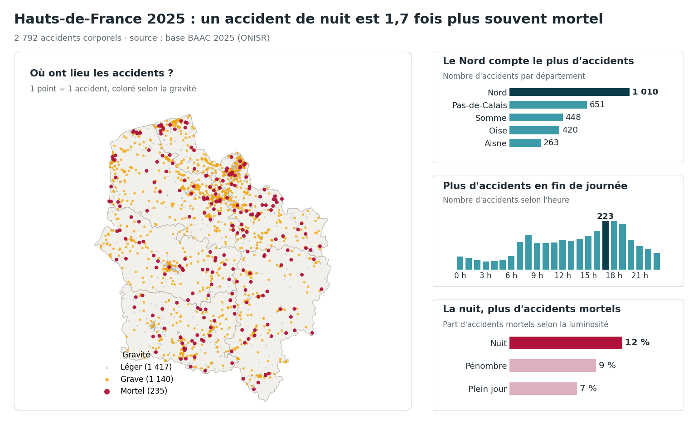

Partie 1: 

Règle 7 : Étiquettes et graduations lisibles
Problème : il y a trop de graduations sur l’axe, le texte est minuscule ou les étiquettes sont penchées. Le lecteur se bat avec l’axe avant même de voir les données.
Correction : simplifier plutôt que pencher le texte. On met moins de graduations et une plus grande police.

Règle 8 : Accessibilité des couleurs
Problème : il y a trop de couleurs, ou des couleurs trop proches. On ne les distingue plus, surtout à l’impression, en projection ou pour une personne daltonienne.
Correction : utiliser peu de couleurs, bien différentes les unes des autres.

Règle 9 : Étiquetage direct
Problème : la légende est loin du graphique. L’œil doit faire des allers-retours entre la légende et les lignes.
Correction : écrire le nom ou la valeur directement à côté des données. Cela marche très bien quand il y a seulement 2 à 4 lignes.

Règle 10 : Éviter le chartjunk
Problème : il y a de la décoration qui n’apprend rien au lecteur : effets 3D, bordures épaisses, ombres, grilles trop serrées.
Correction : enlever tout ce qui n’aide pas à comparer. Si un élément ne sert à rien, il n’a pas sa place.

Règle 11 : Trop de catégories
Problème : il y a trop de catégories dans un même graphique. Le lecteur passe son temps à lire des étiquettes au lieu de comparer.
Correction : regrouper les catégories, en garder seulement les principales, ou faire plusieurs petits graphiques. Mieux vaut montrer moins, mais mieux.

Règle 12 : Trier les barres
Problème : les barres sont dans un ordre au hasard (par exemple l’ordre alphabétique). On ne voit pas facilement la plus grande ni la plus petite.
Correction : les classer de la plus grande à la plus petite. On ne le fait pas quand il existe déjà un ordre logique (les mois, les heures, etc.).

Règle 13 : Points qui se superposent
Problème : dans un nuage de points, il y a tant de points que certains en cachent d’autres. On ne voit plus les zones denses.
Correction : rendre les points transparents, les décaler un peu, les regrouper en cases ou les compter par zone.

Règle 14 : Précision decimale
Problème : il y a trop de décimales (par exemple 12,3456). C’est plus long à lire et cela donne l’impression que le chiffre est plus exact qu’il ne l’est.
Correction : arrondir. Deux décimales au maximum sur un axe, et souvent moins.

Règle 15 : Format des dates
Problème : les dates sont trop longues ou trop nombreuses sur l’axe. Elles se chevauchent et on ne peut plus les lire.
Correction : d’abord mettre moins de dates, puis raccourcir leur format (par exemple « janv. » au lieu de « janvier 2025 »). On penche le texte seulement en dernier recours.

Règle 16 : Économie visuelle
Problème : on veut tout montrer en même temps. Il y a tellement de détails que le message principal se perd.
Correction : simplifier. Garder seulement ce qui sert le message et enlever le reste .

Partie 2 : 

ce dashboard, réalisé avec Python (pandas et matplotlib), présente les accidents corporels de la circulation en 2025 dans les Hauts-de-France, à partir de la base officielle BAAC 2025, et montre où, quand et dans quelles conditions ils ont lieu.
Analyse:

Les accidents sont les plus nombreux dans le Nord, qui en compte 1 010 sur 2 792, soit plus d’un tiers. Ils ont surtout lieu en fin de journée, avec un pic de 223 accidents à 17 h. La nuit, il y a moins d’accidents, mais ils sont plus souvent mortels : 12 % contre 7 % en plein jour, soit environ 1,7 fois plus. Je compare des parts d’accidents, pas le danger de rouler, car je n’ai pas de données sur le trafic.

Choix des graphiques:

J’ai fait une carte avec un point par accident, parce que la base donne la position de chacun. J’ai ajouté trois graphiques en barres, qui sont simples à comparer : un par département pour voir où il y en a le plus, un par heure pour voir quand ils ont lieu, et un sur la luminosité pour voir quand ils sont les plus graves. Pour la luminosité, j’ai pris un pourcentage plutôt qu’un nombre, car le nombre dépend du trafic alors que le pourcentage montre la gravité. Chaque titre donne directement la conclusion, et une seule barre est mise en avant pour guider le regard.

Règles de lisibilité utilisées : 

La règle 8 : j’ai pris des couleurs bien différentes (gris, orange, rouge foncé), et le rouge foncé veut toujours dire « mortel ». La règle 9 : les chiffres sont écrits au bout des barres, donc pas besoin d’échelle. La règle 10 : j’ai enlevé les grilles et les cadres inutiles. La règle 12 : les départements et la luminosité sont classés du plus grand au plus petit, alors que les heures gardent leur ordre normal. La règle 13 : sur la carte, les points sont petits et transparents, et les accidents mortels sont dessinés en dernier pour rester visibles.
